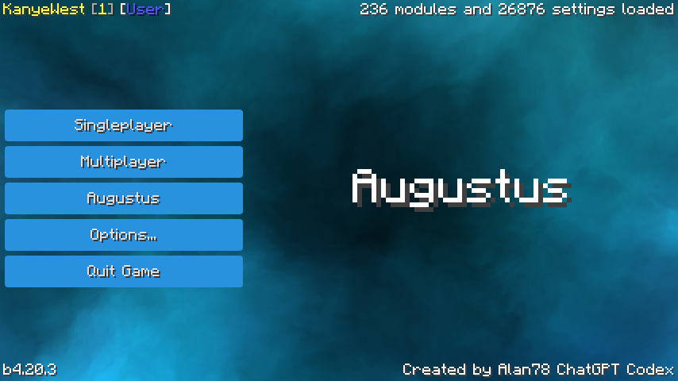
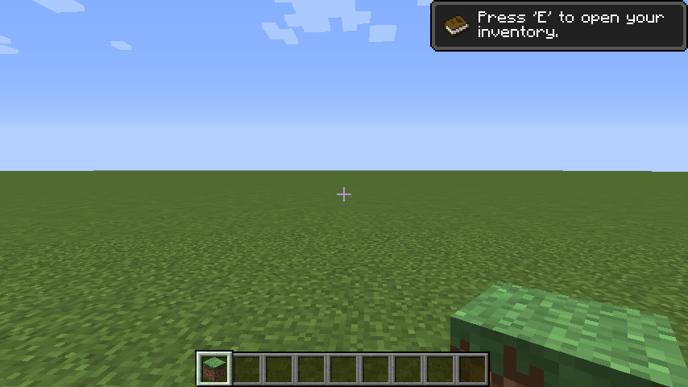

<div align="center">

# OpenAugustus

**Complete, 100% Deobfuscated Java 8 Source Reconstruction (`b4.20.3`)**

[-ED8B00?style=flat-square&logo=openjdk&logoColor=white)](https://adoptium.net/)
[](src/)
[](verify.py)
[](../../releases/latest)

<br />




</div>

---

## Overview

**OpenAugustus** is a full-tree, cleanly compilable Java 8 source reconstruction of **Augustus `b4.20.3`** built on **Minecraft 1.8.9**, **OptiFine**, and **Baritone**.

Building upon the initial open-source initiative by [**NatusV1ncereB1t/OpenAugustus**](https://github.com/NatusV1ncereB1t/OpenAugustus) — which introduced an editable module layer while parts of the core, ZKM key/salt parameters, and control-flow state machines remained obfuscated — this repository completes the engineering effort across the **entire 4,967-file source tree**:

- **100% Clean Java Source (`4,967` files):** Every core class (`4,711`), feature module (`237`), custom extension (`11`), and runtime bootstrapper (`8`) compiles directly from clean `javac --release 8` source with zero residual obfuscation tokens (`C_*`, `field_*`, `method_*`, `CLASS_KEY`, `varN`, or 48-bit ZKM `long` keys).
- **Singleplayer `-1` Crash Eliminated:** Full control-flow unflattening and removal of the `LREM 37L` anti-tamper sabotage state machine in `SupplementalLongEntry`, alongside static initializer (`<clinit>`) restoration across 13 modules and signed-`byte` texture loop overflow fixes.
- **Full ClickGUI, HUD `ArrayList` & Silent Rotation Parity:** Fixed complementing-getter flow sentinel inversion across 31 core/mode classes (`Setting`, `MovementHandler`, `PlayerMovementHistory`, `TickManagerHelper`, `ControllerSupport`, `SimulatedPlayerPath`, `DoubleContainer`, `AttackRangeRenderer`, and 20 `Fly` mode handlers), restored `rotationManager.updateState()` in `SupplementalLongEntry.applyIndex` for `Scaffold` silent rotations, and fixed synchronous `Default.txt` / `English_New.txt` description and setting-name extraction in `SettingsDescriptionsManager` and `SettingsNamesManager`.
- **Strict JVM 8 Verification:** `0` `VerifyError`s and `0` dependency holds under HotSpot Java 8 `-Xverify:all`, validated across `> 81,000` continuous OpenGL frames in 3D Singleplayer.
- **Legacy IRC Subsystem Purged:** Complete, cryptographically verified removal of `IRC`, `IRCChat`, `Radio`, and associated network classes.

> **Technical Documentary:** Read the full reverse-engineering, compiler pipeline, and crash forensics write-up in **[`docs/DEOBFUSCATION_DOCUMENTARY.md`](docs/DEOBFUSCATION_DOCUMENTARY.md)**.

---

## Quick Start — Standalone Client (No Build Required)

To run the client immediately without setting up a build environment:

1. Download **`OpenAugustus-Standalone-b4.20.3.zip`** from **[Releases](../../releases/latest)**.
2. Extract the archive to any folder.
3. Install a **64-bit Java 8 runtime** (e.g., [Adoptium Temurin 8](https://adoptium.net/temurin/releases/?version=8) or Zulu 8).
4. Run **`run-client.bat`** (or launch `java -Xms1G -Xmx2G -XX:+UseG1GC -jar OpenAugustus.jar`).

---

## Building from Source

### Prerequisites
- **Windows 64-bit**
- **Python 3.9+** (`py` or `python` on `PATH`)
- **JDK 17 (64-bit)** — used for batch `javac --release 8` compilation and ASM build tooling (auto-detected or configured via `JDK17_HOME`)
- **JRE / JDK 8 (64-bit)** — used for HotSpot `-Xverify:all` bytecode verification and client execution (auto-detected or configured via `JAVA8_HOME`)

### Commands

```powershell
# 1. Compile all 4,967 Java files from scratch and assemble dist/Augustus-source-development.jar
.\build.ps1

# 2. Verify SHA-256 source fingerprints, pinned inputs, CRC integrity, and IRC removal
.\verify.ps1

# 3. Launch the client
.\run-client.bat
```

> **Note on Split Binary Inputs:** To stay well below GitHub's `100 MB` per-file limit without requiring Git LFS, `lib/launcher-base.jar` is stored as deterministic `< 50 MB` chunks under `build-inputs/parts/`. `build.py` automatically reassembles and SHA-256-verifies it on first run.

---

## Repository Architecture

```text
OpenAugustus/
├── src/
│   ├── main/java/augustus/
│   │   ├── modules/          # 237 clean feature modules across combat, movement, render, player, world, misc
│   │   └── custom/           # Extensibility layer (AlanESP, RuntimeBridge, ClientAccess, ModuleCustomization)
│   ├── dependency/java/      # 4,711 clean core classes (client.*, augustus.modes.*, net.minecraft.*, net.optifine.*, baritone.*)
│   ├── runtime/java/nick/    # 8 overlay bootstrapper and classloader classes
│   └── main/resources/       # 1,008 editable assets, shaders, fonts, and textures
├── tools/                    # Bidirectional ABI mapper, symbol restorer, StackMapFrame repair, and JVM8 verifier
├── build-inputs/             # Reference headers and auto-reassembled launcher chunks
├── lib/                      # Compile headers, ASM 9.7.1, and JavaFX 8 runtime
├── docs/                     # Full engineering documentary and verified OpenGL captures
├── build.py / build.ps1      # Reproducible clean-room build pipeline
├── verify.py / verify.ps1    # Post-build cryptographic and bytecode verification suite
└── run-client.bat            # Portable Java 8 client launcher
```

---

## Verification Summary

| Stage | Scope | Status |
| :--- | :--- | :--- |
| **Source Hygiene Audit** | All `4,967` `.java` files under `src/` | **PASS** — `0` obfuscated identifiers, `0` ZKM `long` keys |
| **Clean Batch Compilation** | `4,711` core + `237` modules + `11` support + `8` runtime | **PASS** — `javac --release 8` (`reused=0`) |
| **Bytecode Verifier** | HotSpot Java 8 `-Xverify:all` | **PASS** — `0` `VerifyError`s, `0` dependency holds |
| **Integrity & IRC Audit** | `verify.py` (`54` pinned inputs + overlay + CRC) | **PASS** — `VERIFY PASSED` |
| **3D Runtime Stability** | Main Menu + Singleplayer world OpenGL session | **PASS** — `> 81,000` frames rendered, `0` crashes |

---

## Credits & Acknowledgments

- **[NatusV1ncereB1t/OpenAugustus](https://github.com/NatusV1ncereB1t/OpenAugustus)** — Credit for the original open-source initiative and foundational partial-deobfuscation release that made this full clean-source reconstruction possible.
- **Claude Opus 5.5**
- **Gemini 4 Carbon & Argon**
