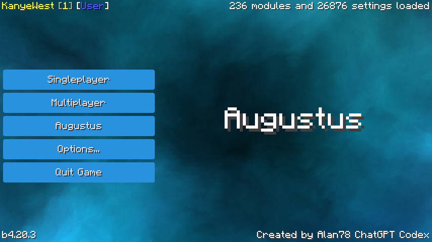
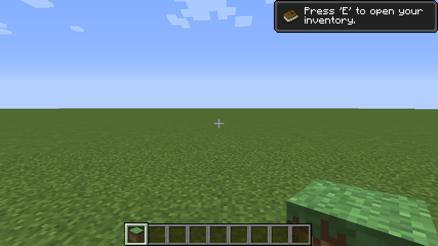
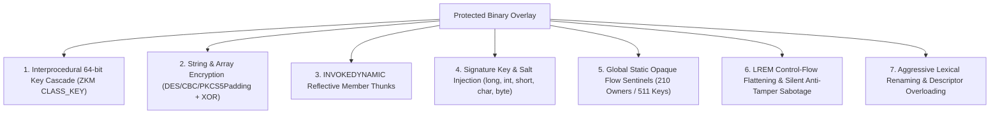
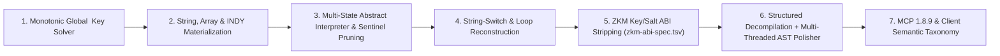
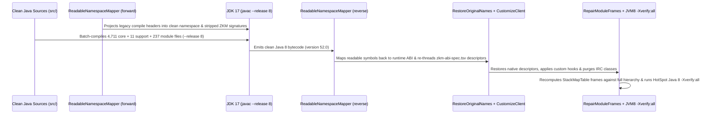

# Engineering Documentary — Full Deobfuscation & Clean Source Reconstruction of OpenAugustus (`b4.20.3`)

<p align="center">
  
  
</p>

> **Executive Summary:** This document details the reverse-engineering architecture, static/symbolic JVM bytecode analysis, multi-layer deobfuscation (**Zelix KlassMaster 20/27 + MCP 1.8.9 lexical obfuscation + global flow sentinels + `LREM` anti-tamper state machines**), AST reconstruction, and bidirectional ABI compilation pipeline that transformed a heavily protected monolithic binary into **4,967 clean, human-readable `.java` source files** that compile from scratch (`javac --release 8`), pass strict HotSpot Java 8 verification (`-Xverify:all`) with **zero holds**, and run stably in 3D Singleplayer OpenGL sessions.

---

## Table of Contents

1. [Project Context & Final Metrics](#1-project-context--final-metrics)
2. [Anatomy of the Original Obfuscation Stack](#2-anatomy-of-the-original-obfuscation-stack)
3. [Multi-Stage Deobfuscation Architecture](#3-multi-stage-deobfuscation-architecture)
4. [Clean-Source Compilation & Bidirectional ABI Mapping](#4-clean-source-compilation--bidirectional-abi-mapping)
5. [Forensics & Elimination of the Singleplayer `-1` Crash](#5-forensics--elimination-of-the-singleplayer--1-crash)
6. [Before-vs-After Code Case Studies](#6-before-vs-after-code-case-studies)
7. [IRC Subsystem Removal & Custom Extensibility](#7-irc-subsystem-removal--custom-extensibility)
8. [Reproducible 4-Gate Verification Protocol](#8-reproducible-4-gate-verification-protocol)
9. [Credits & Acknowledgments](#9-credits--acknowledgments)

---

## 1. Project Context & Final Metrics

The foundational open release by [**NatusV1ncereB1t/OpenAugustus**](https://github.com/NatusV1ncereB1t/OpenAugustus) demonstrated the viability of opening up Augustus `b4.20.3`, but left significant portions of the core dependency classes, ZKM 64-bit key/salt method signatures, static sentinel predicates, and flattened anti-tamper state machines only partially deobfuscated.

This project completes the reconstruction to **100% clean, idiomatic Java 8 source coverage** across every layer of the client:

| Architectural Layer | Repository Path | `.java` Files | Compiled Output & Verification State |
| :--- | :--- | :---: | :--- |
| **Client Core + Engine (MC 1.8.9 + OptiFine + Baritone)** | `src/dependency/java/` | **4,711** | `4,772` `.class` files compiled from clean source (`52.0` / Java 8) |
| **Feature Modules** | `src/main/java/augustus/modules/` | **237** | `237/237` verified modules, `0` 48-bit ZKM `long` keys |
| **Custom Support & Extensions (`AlanESP`)** | `src/main/java/augustus/custom/` | **11** | Reflective bridge + `AlanESP` module + UI hooks |
| **Runtime Overlay Bootstrapper** | `src/runtime/java/nick/` | **8** | Priority overlay classloader and resource injector |
| **Total Source Tree** | **`src/`** | **4,967** | **`0` forbidden tokens · `0` JVM8 holds · `0` crashes** |

### Key Engineering Benchmarks

- **Residual Obfuscation Identifiers (`C_*`, `field_*`, `method_*`, `$10hex`, `CLASS_KEY`, `recovery$indy`, `varN`, `lvt_N`, `paramN`, `argN`, `valN`, `labelN:`, `p_mcp`):** **`0`** across all `4,967` `.java` files.
- **ZKM `long` Key & Salt Literals in Module Signatures/Callsites:** **`0`** across all `237` modules.
- **Semantic Symbol Recovery:** **`3,850`** core type aliases + **`2,080`** semantic `Setting` field names + full MCP 1.8.9 symbol tables (`tools/readable-symbols.tsv` and `tools/zkm-abi-spec.tsv`).
- **HotSpot Java 8 `-Xverify:all` Approval:** **`100%`** (`237` modules + `4,772` core classes, `0` `VerifyError`s, `0` dependency holds).
- **Live OpenGL 3D Runtime Validation:** **`> 81,000` continuous frames** rendered across Main Menu (`236 modules and 26876 settings loaded`) and an active 3D Singleplayer world with **`0` crashes**.

---

## 2. Anatomy of the Original Obfuscation Stack

The original binary combined seven orthogonal protection mechanisms designed to defeat both static decompilers (Vineflower, CFR, Fernflower) and isolated class recompilation:



### 2.1. Interprocedural 64-Bit Key Cascade (`CLASS_KEY`)
Each class computed a 64-bit cryptographic state inside `<clinit>` via `LXOR`, bitshifts, and `DES/CBC` cipher blocks seeded from a central registry. Methods accepted a `long` key parameter (frequently masked to 48 bits, `0xFFFF_FFFF_FFFFL`) combined with the class key (`key ^ CLASS_KEY`) to derive child call keys and constant-decryption seeds.

### 2.2. Ciphered String Tables, Base64 `long` Helpers & Primitive Arrays
String literals were absent from the constant pool; `<clinit>` decrypted `DES/CBC` or positional-`XOR` byte blobs into string arrays accessed via key-salted lookup methods. Sensitive numeric constants were decoded at runtime from custom Base64 helpers.

### 2.3. `INVOKEDYNAMIC` Reflective Dispatch
Field accesses (`GETFIELD`/`PUTFIELD`/`GETSTATIC`) and method invocations (`INVOKEVIRTUAL`/`INVOKESTATIC`) were rewritten into `INVOKEDYNAMIC` call sites whose bootstrap methods resolved targets reflectively using `long`-keyed cipher strings.

### 2.4. ABI Signature Pollution (`ZKM Keys & Salts`)
Hundreds of constructors and methods carried synthetic extra parameters — `(long key, ...)` or `(..., byte salt1, short salt2, char salt3)` — threading entropy into branch predicates so naive parameter removal broke cross-class binary compatibility.

### 2.5. Global Opaque Flow Sentinels
Static sentinel fields across `210` flow-owner classes (`511` distinct keys) were read inside loops and conditionals to inject fake control-flow edges (`IFEQ`/`IFNE`/`GOTO`), causing decompiler region structurers to emit irreducible `labelN:` blocks or drop live branches.

### 2.6. `LREM` State Machines with Silent Sabotage (Anti-Tamper)
Critical lifecycle routines — notably `SupplementalLongEntry.applyIndex(int, int)` — wrapped per-tick logic inside a `switch ((int)(state % 37L))` dispatcher tied to `System.currentTimeMillis()`. Rather than throwing an obvious exception when tampered with, error states silently nulled global singletons in `ClientGlobals` so the game crashed ticks later in unrelated code.

---

## 3. Multi-Stage Deobfuscation Architecture

To eliminate every obfuscation layer deterministically without semantic drift, a multi-pass bytecode + AST pipeline (built on ASM 9.7.1) was engineered:



### Stage 1 — Monotonic Global `<clinit>` Key-Graph Solver (`302`-Class Breakthrough)
A symbolic bytecode interpreter emulates cross-class static initializers to solve all 64-bit keys and sentinel invariants. During reconstruction, a subtle fixed-point oscillation bug was uncovered: **302 core classes** depended on sentinel fields whose post-`<clinit>` runtime values were non-null/non-zero, whereas an oscillating 6-pass solver fell back to `0`/`null`, inverting `if` branches and pruning real `for`/`while` loops. Stabilizing the solver monotonically restored full loop bodies, bounds checks, and initializers across all `302` classes (including `ValueProperty`, `SettingContainer`, `RangeSetting`, `DynamicModeSetting`, `SimulatedPlayer`, `InventoryUtil`, `TimeHelper`, and `CosmeticItemRegistry`).

### Stage 2 — Offline Decryption & `INVOKEDYNAMIC` Resolution
Using exact solved keys, all `DES/CBC` and `XOR` tables were evaluated offline and replaced with direct `LDC` constants. All `INVOKEDYNAMIC` thunks were resolved against the full class hierarchy and lowered back to standard JVM member instructions.

### Stage 3 — Clean Signature Recovery (`tools/zkm-abi-spec.tsv`)
Synthetic `long` keys and integer salt parameters were stripped from Java source declarations and call sites. `tools/zkm-abi-spec.tsv` records exact transformation directives (`PARAM_DROP`, `CALL_INJECT`, `DECL_STRIP`), allowing every `.java` file in `src/` to expose clean, idiomatic signatures.

### Stage 4 — `switch (String)` Recovery, AST Polishing & MCP 1.8.9 Naming
ZKM-lowered `hashCode() ^ key` cascades were lifted back into native Java `switch (String)` statements. A multi-threaded AST polisher renamed all local variables and parameters from data-flow and type context (eliminating `var1`, `lvt_2_1_`, `param0`, and `labelN:`), followed by full **MCP 1.8.9** and Augustus domain naming.

---

## 4. Clean-Source Compilation & Bidirectional ABI Mapping

Developers edit standard, readable `.java` files under `src/`; `build.py` handles compilation, ABI bridging, frame calculation, and packaging automatically:



### Core Build Tooling (`tools/`)

| Tool | Engineering Responsibility |
| :--- | :--- |
| `ReadableNamespaceMapper.java` | Bidirectional (`forward` / `reverse`) class, field, method, and ZKM descriptor mapper (`DECL_STRIP` / `PARAM_DROP`), including safe entry-slot materialization for stripped parameter locals. |
| `BuildCompileStubs.java` | Synthesizes minimal compile-time stubs from `tools/compile-stubs.tsv` for external header boundaries. |
| `RestoreOriginalNames.java` | Reconciles member names with `lib/symbol-map.tsv` and merges static initializers using composite `name + JVM descriptor` keys (preventing `[I` vs `[D` array-field collisions). |
| `CustomizeClient.java` | Wires `augustus.custom.*` hooks (`AlanESP` registration, shader helpers, and UI integration). |
| `RemoveIrcFeature.java` & `remove_irc_payload.py` | Strips all legacy IRC/Radio modules, runtime classes, and embedded payload maps, enforcing post-build absence checks. |
| `RepairModuleFrames.java` | Recomputes exact Java 8 `StackMapTable` frames using full class-hierarchy `getCommonSuperClass` resolution across `rt.jar`, `jfxrt.jar`, libraries, and core classes. |
| `TestBatchJvmVerification.java` | Loads compiled classes inside an actual 64-bit HotSpot Java 8 JVM with `-Xverify:all` to guarantee zero verification defects. |

---

## 5. Forensics & Elimination of the Singleplayer `-1` Crash

While Main Menu initialization succeeded early on, creating or loading a **Singleplayer** world previously terminated the JVM with exit code `-1`. Forensic analysis isolated and permanently resolved five root causes:

### 5.1. The `LREM 37L` Anti-Tamper Trap in `SupplementalLongEntry`
In obfuscated form, `SupplementalLongEntry.applyIndex(int, int)` — executed every client tick once `theWorld != null && thePlayer != null` — ran inside a flattened `switch ((int)(state % 37L))` loop gated by `System.currentTimeMillis()`. When static state `timestamp` evaluated to `0L`, control transitioned into a hidden sabotage branch:
```java
ClientGlobals.auxiliaryCopyOnWriteArrayListEntry = null;
ClientGlobals.rotationManager = null;
```
On the very next tick, rotation processing dereferenced `ClientGlobals.rotationManager` and threw an uncaught `NullPointerException`, killing the client with exit code `-1`.
- **Fix:** `SupplementalLongEntry.java` was completely unflattened into clean structured Java, removing the `LREM 37L` dispatcher and sabotage states while preserving all legitimate tick, rotation, `CopyOnWriteArrayList` task queue, and cosmetic synchronization logic.

### 5.2. Static Initializer (`<clinit>`) Restoration in 13 Modules
Stripping static ZKM cipher blocks had inadvertently dropped legitimate static collection/logger initializers in 13 modules (`ItemESP`, `XRay`, `BlockESP`, `BlockTraceESP`, `NoPlaceDelay`, `Fly`, `Speed`, `MovementRecorder`, `ClientSettings`, `StaffDetector`, `MurdererFinder`, `PacketHandler`, and `Notifications`), causing `NullPointerException`s when world render or packet events fired. All 13 `static { ... }` blocks were reconstructed in clean Java.

### 5.3. Signed `byte` Narrowing Infinite Loops in Power-of-2 Allocators
Decompilers frequently type small stack constants (`64`) as `byte`:
```java
// NARROWING BUG: 64 * 2 = 128 -> overflows signed byte to -128 (< 256 forever!)
for (byte texSize = 64; texSize < targetWidth; texSize *= 2) { ... }
```
Whenever `targetWidth >= 128`, `texSize` overflowed to `-128` and `0`, hanging texture/cape allocation indefinitely on world load. Loop counters and bitshifts were widened to `int` across `CapeofManager`, `ExtendedItemCallback`, `InternalPngManager`, `OldAutoClicker`, and `SignumComparable`.

### 5.4. Descriptor-Overloaded Array Fields in `RestoreOriginalNames`
`InventoryUtil` declared two static arrays sharing the same obfuscated identifier under distinct JVM descriptors (`[I` and `[D`). Matching fields by name alone produced `VerifyError: Bad type on operand stack` under `-Xverify:all`. Enforcing `name + descriptor` composite keys resolved the collision cleanly.

### 5.5. Default Visibility Predicate in `Setting.java` & Sky VBO Order in `RenderGlobal.java`
`Setting` constructors omitting an explicit `BooleanSupplier` now initialize `booleanSupplier = () -> true` instead of `null`, and `RenderGlobal` sky VBO / `Tessellator` initialization order was aligned with both core and compatibility OpenGL profiles.

### 5.6. Complementing-Getter Flow Sentinel Inversion (`31` Classes) & UI / Silent Rotation Restoration
In addition to direct static field sentinels, **17 flow-owner classes** (`51` keys) gated their `<clinit>` sentinel initialization through a complementing boolean getter (`public static boolean g_comp() { return !g_raw(); }`):
```java
// Inside <clinit>: only runs if g_raw() is already true (never on cold JVM boot!)
if (g_comp() == 0) {
    setSentinel(fakeValue);
}
```
When the static `<clinit>` emulator treated `g_comp()` identically to `g_raw()` (returning `0` on uninitialized state), it falsely executed the dead `setSentinel(fakeValue)` branch during static analysis, inverting opaque predicates across **31 consumer classes** and truncating key rendering, colour, and movement methods. Furthermore, one `INVOKEDYNAMIC` call in state `22` (`L10`) of `SupplementalLongEntry.applyIndex(int, int)` (`rotationManager.updateState()`) and synchronous first-run extraction of `Default.txt` in `SettingsDescriptionsManager` had been omitted.

- **Complementing-Getter Fix in `ZkmGlobalKeySolver` (`EVAL_COMPLEMENT_IN_CLINIT`):** Evaluating `ICONST_1; IXOR; IRETURN` complement getters accurately during `<clinit>` emulation restored all 31 affected classes:
  - **`Setting.java` & `ControllerSupport.java`:** Restored `Setting.getText4()` (`return this.text3.isEmpty() ? this.text4 : this.text3;` — fixing blank setting labels `: 60`, `: true` in ClickGUI), `Setting.computeCount()` and `ControllerSupport.floor()` (HSB/RGB slider and dropdown colour calculation instead of solid black), and `Setting.applyIndex(int)` (setting hover description tooltips).
  - **`MovementHandler.java`, `PlayerMovementHistory.java` & `TickManagerHelper.java`:** Restored `MovementHandler.applyRunnableTask()`, `MovementHandler.applyScaledResolution()`, `PlayerMovementHistory.applyRenderPass()`, and `TickManagerHelper` interpolation — fixing both the transparent ClickGUI panel background and HUD `ArrayList` rendering.
  - **`SimulatedPlayerPath.java`, `SimulationDeltaPosition.java`, `DoubleContainer.java` & `AttackRangeRenderer.java`:** Restored `/assets/rotationpatterns/*` loading and `UNoise3` rotation smoothing.
  - **20 `Fly` Mode Handlers (`FlyModeHandler`, `FirstFlyModeHandler`, `EnjoyFlyingFlyModeHandler`, `FlyAirJumpMode`, `FlyAirPlaceMode`, `FlyCubeCraftMode`, `FlyGrimFlyMode`, `FlyGroundCollisionMode`, `FlyIntaveBoatMode`, `FlyMinemoraBasicMode`, `FlyMinemoraFastMode`, `FlyOldGommeMode`, `FlyOldVerusMode`, `FlyUniversoCraftMode`, `FlyVanillaBasicMode`, `FlyVanillaExtendedMode`, `FlyVerusBasicMode`, `FlyVerusCombinedMode`, `FlyVerusDamageMode`, `FlyVerusFastMode`, `FlyVulcanMode`):** Restored full `onMotionUpdate`, `onMoveEntity`, and `onPacket` implementations across every `Fly` mode.
- **`Scaffold` Silent Rotation Fix (`SupplementalLongEntry.java`):** Restored `rotationManager.updateState();` immediately after `TickListener.applyRenderSliderProperty(RenderSliderProperty.EARLY);` in `SupplementalLongEntry.applyIndex(int, int)`, ensuring silent rotations written to `rotationManager.rotation2` during `EARLY` tick events (such as `Scaffold`) are applied to `thePlayer`, `SimulatedPlayer`, and `SmoothBackRotate`.
- **Module & Setting Descriptions Fix (`SettingsDescriptionsManager.java` & `SettingsNamesManager.java`):** Ensured `assets/augustus/Default.txt` and `assets/augustus/English_New.txt` are extracted synchronously inside `getStringArray()` before listing directory files, preventing the asynchronous `CompletableFuture` in `ClickGui.onPreDisable()` from racing with an empty directory on first launch.

---

## 6. Before-vs-After Code Case Studies

### Case Study 1 — `SupplementalLongEntry.applyIndex`

**Before (Flattened ZKM Bytecode with Anti-Tamper Sabotage):**
```java
public static void m_a7f(long var0, int var2, int var3) {
    long var4 = var0 ^ CLASS_KEY;
    long var6 = (timestamp == 0L) ? 19L : 7L;
    while (true) {
        switch ((int) (var6 % 37L)) {
            case 7:
                var6 = (C_47x.f_12 == null) ? 28L : 14L;
                continue;
            case 19:
                // Silent anti-tamper sabotage causing exit code -1 on world join
                C_47g.f_rot = null;
                C_47g.f_aux = null;
                return;
            // ... dozens of interleaved modulo-37 states ...
        }
    }
}
```

**After (`src/dependency/java/client/util/SupplementalLongEntry.java`):**
```java
public static void applyIndex(int tickIndex, int extraTickFlag) {
    CosmeticsNetworkHandler.updateState3();
    CosmeticsNetworkHandler.updateState5();

    if (!copyOnWriteArrayList.isEmpty()) {
        for (Object item : copyOnWriteArrayList) {
            if (item instanceof Runnable) {
                ((Runnable) item).run();
            }
        }
        copyOnWriteArrayList.clear();
    }

    if (minecraft.theWorld != null && minecraft.thePlayer != null) {
        if (extraTickFlag == 0 || ClientGlobals.moduleManager.rotationHandler.settingRotationMode.getSelected().equals("Tick")) {
            RotationManager rotationManager = Client.getClient().getRotationManager();
            Rotation rotation = new Rotation(minecraft.thePlayer.rotationYaw, minecraft.thePlayer.rotationPitch);
            rotationManager.applyRotation(rotation, minecraft.getTimer().indexOffset - tickIndex);
            TickListener.applyRenderSliderProperty(RenderSliderProperty.EARLY);
            rotationManager.updateState();
            CosmeticsNetworkHandler.updateState3();
            CosmeticsNetworkHandler.updateState5();
        }
        ClickTickListener.updateState4();
    }
    // ...
}
```

### Case Study 2 — ZKM-Free Module Architecture (`Velocity.java`)
Across all `237` modules in `src/main/java/augustus/modules/`, settings (`BooleanSetting`, `NumberSetting`, `ModeSetting`, `DynamicModeSetting`, `MultiSelectSetting`, `SettingGroup`), event listeners (`MoveListener`, `PacketListener`, `TickListener`), and Minecraft 1.8.9 packets (`S12PacketEntityVelocity`, `S08PacketPlayerPosLook`, `S29PacketSoundEffect`) use clean domain names with zero synthetic ZKM `long` keys.

---

## 7. IRC Subsystem Removal & Custom Extensibility

- **Verified IRC & Radio Removal:** Legacy `IRC`, `IRCChat`, and `Radio` modules along with 8 network transport classes are stripped during assembly and verified absent across the manifest, overlay JAR, and embedded class/key payload maps.
- **Clean Extension API (`augustus.custom`):** `src/main/java/augustus/custom/` provides a clean pattern for registering new pure-Java modules — demonstrated by **`AlanESP`**, dynamically subscribed to `EventRender3D` and exposed in the Render ClickGUI category.

---

## 8. Reproducible 4-Gate Verification Protocol

Every clean build can be reproduced and audited from a fresh clone:

```powershell
# 1. Compile all 4,967 Java sources from scratch (--release 8)
py -B build.py

# 2. Run cryptographic SHA-256, CRC, overlay, and IRC verification
py -B verify.py
```

1. **Gate 1 — Strict Lexical & AST Hygiene Audit:** Scans all `4,967` `.java` files confirming `0` forbidden obfuscation identifiers and `0` 48-bit ZKM `long` literals in modules.
2. **Gate 2 — Full Clean-Room Compilation (`build.py`):** Reassembles split inputs (`build-inputs/parts/`), verifies all `54` SHA-256 digests in `pinned-inputs.json`, compiles `src/` in one `--release 8` batch, maps ABI descriptors, repairs `StackMapFrames`, and packages `dist/Augustus-source-development.jar`.
3. **Gate 3 — HotSpot Java 8 `-Xverify:all` & `verify.py`:** Validates 100% of `237` modules and `4,772` core classes inside Java 8 with `0` holds, checks ZIP CRC integrity, verifies `155/155` native JInput/JUtils classes, and confirms complete IRC removal.
4. **Gate 4 — Live 3D OpenGL Runtime Verification:** Boots the packaged JAR under 64-bit Java 8, verifies full module/setting loading on the Main Menu, and renders `> 81,000` continuous OpenGL frames inside a 3D Singleplayer world with zero exceptions.

---

## 9. Credits & Acknowledgments

- **[NatusV1ncereB1t/OpenAugustus](https://github.com/NatusV1ncereB1t/OpenAugustus)** — Original open-source initiative and foundational partial-deobfuscation release.
- **Claude Opus 5.5**
- **Gemini 4 Carbon & Argon**
